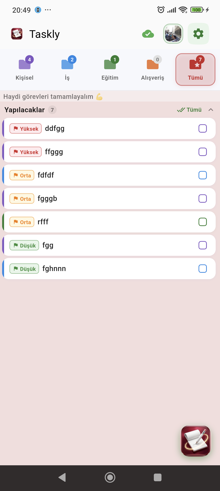
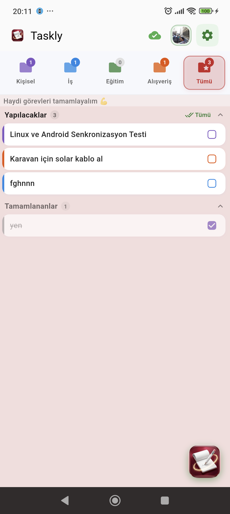

# 📝 Taskly

<p align="center">
  
</p>

<p align="center">
  <strong>Taskly</strong> is a sleek, responsive, and minimalist to-do list application crafted with Flutter, featuring real-time bidirectional cloud synchronization between <strong>Android</strong>, <strong>Linux Desktop</strong>, and the <strong>Web</strong>.
</p>

<p align="center">
  <a href="https://play.google.com/store/apps/details?id=com.note.taskly"></a>
  <a href="https://taskly-notes.web.app"></a>
  <a href="https://taskly-notes.web.app/downloads.html">Download Taskly 1.0.28 — Linux / Arch</a>
</p>

---

## 📱 Screenshots

<p align="center">
  
  &nbsp;&nbsp;&nbsp;&nbsp;
  
  &nbsp;&nbsp;&nbsp;&nbsp;
  
</p>

---

## Taskly 1.0.28 — Linux / Arch Linux

Taskly is a Flutter to-do app with 10 languages, with English as the default. Tasks sync across Android, Linux and the web when signed in with the same Google account. Offline changes merge when the app reconnects.

**Current downloads:** [taskly-notes.web.app/downloads.html](https://taskly-notes.web.app/downloads.html)

[Web app](https://taskly-notes.web.app/) · [Google Play](https://play.google.com/store/apps/details?id=com.note.taskly) · [Guide](https://taskly-notes.web.app/guide_taskly.html) · [Privacy](https://taskly-notes.web.app/privacy_taskly.html) · [Account deletion](https://taskly-notes.web.app/delete-account.html)

## Arch Linux installation

This repository provides the PKGBUILD installation recipe. **There is currently no official AUR listing for `taskly-bin`.**

```bash
git clone https://github.com/mebsoruhavuzu-boop/taskly.git
cd taskly
makepkg -si
```

The recipe downloads the versioned Linux archive from Taskly Firebase Hosting, verifies its SHA-256 checksum, and installs the app in `/opt/taskly` with a launcher and desktop entry. GTK 3, libepoxy, the Ayatana AppIndicator runtime and libsecret are declared as dependencies.

Alternatively, download the ready-built Arch package from the downloads page and install it with:

```bash
sudo pacman -U taskly-bin-1.0.28-1-x86_64.pkg.tar.zst
```

## Ubuntu, Debian and Fedora (x86_64)

Download `taskly_1.0.28-1_amd64.deb` or `taskly-1.0.28-1.x86_64.rpm` from the [downloads page](https://taskly-notes.web.app/downloads.html) or this repository's Releases, then install it with your package manager so dependencies are resolved:

```bash
sudo apt install ./taskly_1.0.28-1_amd64.deb      # Ubuntu 24.04+, Debian 13+
sudo dnf install ./taskly-1.0.28-1.x86_64.rpm     # Fedora 39+
```

These packages require glibc 2.38 or newer. Ubuntu 22.04 and Debian 12 are not supported. They are not published in an apt/dnf repository: to update, download the new package and install it the same way.

## Other Linux distributions (x86_64)

Download `taskly-1.0.28-x86_64.tar.gz` and compare its checksum with the published `SHA256SUMS`. Extract the complete bundle:

```bash
mkdir -p taskly-1.0.28
tar -xzf taskly-1.0.28-x86_64.tar.gz -C taskly-1.0.28
./taskly-1.0.28/taskly
```

Keep `taskly`, `lib/`, and `data/` together. Requires glibc 2.38+. Install GTK 3, the Ayatana AppIndicator runtime, libsecret and GStreamer using your distribution's package manager. Linux reminders require the app to be running; web reminders are not supported.

## 1.0.28 changes

- Linux: new "Start at login" switch in Settings → Notifications & Sound. Taskly then starts in the tray without a window when you log in (`~/.config/autostart/taskly.desktop`, `--hidden`), so reminders keep working.
- Linux: reminders whose time passed while Taskly was not running are listed in a single "missed reminders" notification.
- Android: alarms added on Linux or the web are synced in the background about every 15 minutes and set even while the app is closed.
- The formatting bar (bold, italic, strikethrough, lists) with Ctrl+B, Ctrl+I and Ctrl+Shift+X shortcuts is included.

The current Linux/Arch binaries are distributed through the downloads page. Older GitHub Releases remain historical artifacts. The Android store version depends on Google Play review and rollout.

## Platform Synchronization Policy / Platform Senkronizasyon Kuralı

Taskly updates are strictly synchronized across all distribution channels:
1. **Google Play Store:** Official Android app releases (AAB/APK) and release notes (TR & EN, ≤500 chars).
2. **Linux (Arch, Ubuntu/Debian, Fedora):** Arch package (`taskly-bin`), DEB and RPM packages built from the same release archive, `PKGBUILD`, `.SRCINFO`, and download archives on Firebase Hosting and GitHub Releases.
3. **GitHub Repository:** `PKGBUILD`, `.SRCINFO`, **`README.md`** (this file — version number, package names, changelog section, and Turkish description must all be updated in the same commit as PKGBUILD/.SRCINFO).
4. **Web Guide & Privacy Policy:** `https://taskly-notes.web.app/guide_taskly.html` and `privacy_taskly.html` — deployed to Firebase Hosting.

Whenever a new release is prepared, version tags, binaries, build recipes, and this README across all channels must remain in **100% lockstep parity**. No channel may be left on a stale version tag.

## Türkçe kısa bilgi

Güncel Linux, Arch, Ubuntu/Debian (.deb) ve Fedora (.rpm) paketleri yukarıdaki indirme sayfasındadır; DEB ve RPM paketleri Ubuntu 24.04+, Debian 13+ ve Fedora 39+ gerektirir. Bu depo kurulum tarifini içerir; resmî AUR kaydı değildir. Aynı Google hesabıyla Android, Linux ve web görevleri eşitlenir. Tüm cihazları güncelleyin. Linux hatırlatıcıları uygulama çalışırken kullanılır; web hatırlatıcıları desteklenmez.

Sürüm 1.0.28 ile Linux'ta Ayarlar'a "Oturum açılınca başlat" anahtarı eklendi; Taskly oturum açılınca pencere göstermeden tepside başlar. Uygulama kapalıyken saati geçen hatırlatıcılar tek bildirimde gösterilir; Android'de başka cihazda eklenen alarmlar arka planda eşitlenip kurulur.
