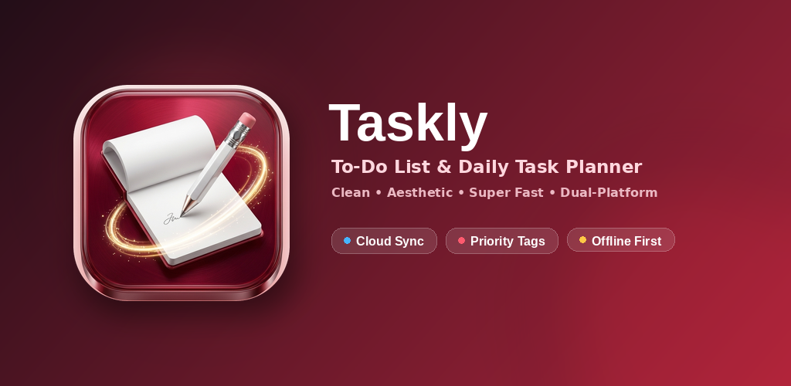
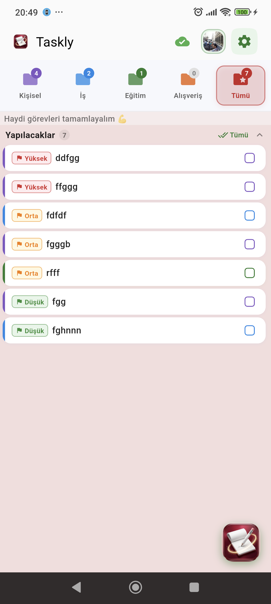
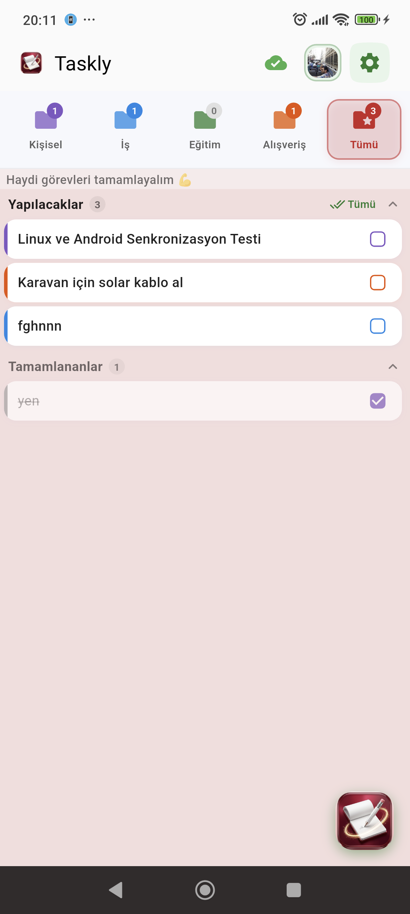

# 📝 Taskly

<p align="center">
  
</p>

<p align="center">
  <strong>Taskly</strong> is a sleek, responsive, and minimalist to-do list application crafted with Flutter, featuring real-time bidirectional cloud synchronization between <strong>Android</strong>, <strong>Linux Desktop</strong>, <strong>Windows Desktop</strong>, and the <strong>Web</strong>.
</p>

<p align="center">
  <a href="https://play.google.com/store/apps/details?id=com.note.taskly"></a>
  <a href="https://taskly-notes.web.app"></a>
  <a href="https://github.com/mebsoruhavuzu-boop/taskly/releases/tag/v1.0.39"></a>
  <a href="https://taskly-notes.web.app/downloads.html">Download Taskly 1.0.39 — Linux / Arch / Windows</a>
</p>

---

## 📱 Screenshots

<p align="center">
  
  &nbsp;&nbsp;&nbsp;&nbsp;
  
  &nbsp;&nbsp;&nbsp;&nbsp;
  
</p>

---

## Taskly 1.0.39 — Linux, Windows & Arch Linux

Taskly is a Flutter to-do app with 10 languages, with English as the default. Tasks sync across Android, Linux, Windows and the web when signed in with the same Google account. Offline changes merge when the app reconnects.

**Current downloads:** [taskly-notes.web.app/downloads.html](https://taskly-notes.web.app/downloads.html)

[Web app](https://taskly-notes.web.app/) · [Google Play](https://play.google.com/store/apps/details?id=com.note.taskly) · [Guide](https://taskly-notes.web.app/guide_taskly.html) · [Privacy](https://taskly-notes.web.app/privacy_taskly.html) · [Account deletion](https://taskly-notes.web.app/delete-account.html)

## Arch Linux installation

This repository provides the PKGBUILD installation recipe. **There is currently no official AUR listing for `taskly-bin`.**

```bash
git clone https://github.com/mebsoruhavuzu-boop/taskly.git
cd taskly
makepkg -si
```

The recipe downloads the versioned Linux archive from Taskly Firebase Hosting, verifies its SHA-256 checksum, and installs the app in `/opt/taskly` with a launcher and desktop entry. GTK 3, libepoxy, the Ayatana AppIndicator runtime and libsecret are declared as dependencies.

Alternatively, download the ready-built Arch package from the downloads page and install it with:

```bash
sudo pacman -U taskly-bin-1.0.39-1-x86_64.pkg.tar.zst
```

## Ubuntu, Debian and Fedora (x86_64)

Download `taskly_1.0.39-1_amd64.deb` or `taskly-1.0.39-1.x86_64.rpm` from the [downloads page](https://taskly-notes.web.app/downloads.html) or this repository's Releases, then install it with your package manager so dependencies are resolved:

```bash
sudo apt install ./taskly_1.0.39-1_amd64.deb      # Ubuntu 24.04+, Debian 13+
sudo dnf install ./taskly-1.0.39-1.x86_64.rpm     # Fedora 39+
```

These packages require glibc 2.38 or newer. Ubuntu 22.04 and Debian 12 are not supported. They are not published in an apt/dnf repository: to update, download the new package and install it the same way.

## Other Linux distributions (x86_64)

Download `taskly-1.0.39-x86_64.tar.gz` and compare its checksum with the published `SHA256SUMS`. Extract the complete bundle:

```bash
mkdir -p taskly-1.0.39
tar -xzf taskly-1.0.39-x86_64.tar.gz -C taskly-1.0.39
./taskly-1.0.39/taskly
```

Keep `taskly`, `lib/`, and `data/` together. Requires glibc 2.38+. Install GTK 3, the Ayatana AppIndicator runtime, libsecret and GStreamer using your distribution's package manager. Linux reminders require the app to be running; web reminders are not supported.

## Windows 10 / 11 (x64)

Download `Taskly-Setup-1.0.39.exe` (user-level installer, no administrator privileges required, TR/EN) or `taskly-1.0.39-windows-x64.zip` (portable archive) from [GitHub Releases (v1.0.39)](https://github.com/mebsoruhavuzu-boop/taskly/releases/tag/v1.0.39) and verify the SHA-256 checksum in PowerShell:

```powershell
Get-FileHash .\Taskly-Setup-1.0.39.exe -Algorithm SHA256
# 806af0f4f5bdd9eaf69d5e3842783245912fbb7e230fbd634c748fa2b27e6b24

Get-FileHash .\taskly-1.0.39-windows-x64.zip -Algorithm SHA256
# 0266ddb03d02a0f8dd4c42496422a87d722fc557303f10c06c8e202b37c41541
```

Because the installer is not code-signed, Windows SmartScreen may show a warning on first launch — choose **More info → Run anyway** (TR: *Ek bilgi → Yine de çalıştır*). Windows reminders require the app to be running (closing the window minimizes Taskly to the system tray).

## 1.0.39 changes

- Android: upgraded bottom ad bars to Anchored Adaptive Banners, improved inline native ad placement in long task lists, added smart load delays on secondary screens, and published `app-ads.txt` alongside dedicated GDPR support.
- Linux 1.0.39-1 maintains full parity with all 1.0.38 features, Wayland/EGL fixes, and cloud sync.
- Windows 1.0.39 (x64): official Windows Desktop release (`Taskly-Setup-1.0.39.exe` installer and `taskly-1.0.39-windows-x64.zip` portable bundle) with Google cloud sync, system tray support, single-instance guard, and local reminder notifications with alarm audio (ad-free).

## 1.0.38 changes

- Cleaner top layout: search, saved search filters and sort moved to the top bar; Share moved to Settings; dark mode search text contrast fixed; status header and "+ New Category" combined into one row.
- Added one-tap Today and Overdue quick filter chips when matching tasks exist.
- Tap any incomplete task card to edit directly; subtasks checklists are now active in add/edit forms with live progress badges on task cards and the calendar.
- Long-press multi-select (bulk complete and move) is now available in the "All" tab as well as category tabs, and task list scrolling is smoother.
- Android: upgraded to adaptive bottom banners (including Calendar) and dark/light theme-aware inline native ads; zero empty bottom strip when ad-free or on Linux/Web.

## 1.0.37 changes

- Cut, Copy and Paste are separate buttons in the task text toolbar on Android and Linux. Cut and Copy are disabled until text is selected; Paste reads from the system clipboard.
- Verified the actions in both add and edit task flows on an Android API 36 emulator. Linux clipboard buttons are covered by widget tests.

## 1.0.36 changes

- Android task text selection menus no longer show Share or system text-processing actions such as Read aloud. Cut, Copy, Paste and Select all remain available.
- Linux task text selection menus no longer show Share. Keyboard shortcuts and clipboard controls remain available.

### Included from 1.0.35


- **Linux 1.0.35-2:** Fixes a black window on Wayland with Mesa 26.3+ by falling back to X11/XWayland automatically when GTK 3 cannot acquire a Wayland EGL configuration (explicit `GDK_BACKEND` overrides are still respected).
- Add and edit task screens: the text area now fills all free space, and the category, priority, due date and tag rows sit right above the Save button. With the keyboard open the text area shrinks and the rest scrolls.

### Included from 1.0.34

- Manage your own categories: rename or delete any category except "All" (the four built-in ones included), and create new top-level categories and one-level subcategories.
- Move tasks between categories. When deleting a category that has tasks, choose "Delete with tasks" or "Move and delete"; "Undo" restores everything.
- Tree view: a category shows its own tasks and subfolder rows, and "All" shows every task as a collapsible folder tree. The folder badge also counts tasks in subcategories.
- Category options (long-press, the ⋮ button, or a header in the "All" tree) include "Add a task" and "New subcategory".
- Categories are included in cloud sync and JSON backups.
- Reliability: changes sync correctly even if the device clock is set back, broken or circular category links are repaired, a failing category merge no longer stops task sync, and category errors are reported to the user.
- Compatibility: version 1.0.31 and earlier do not recognise custom categories. Update all devices to 1.0.39.

The current Linux/Arch binaries are distributed through the downloads page. Only the current and the previous GitHub Release are kept; older releases are removed. The Android store version depends on Google Play review and rollout.

## Platform Synchronization Policy / Platform Senkronizasyon Kuralı

Taskly updates are strictly synchronized across all distribution channels:
1. **Google Play Store:** Official Android app releases (AAB/APK) and release notes (TR & EN, ≤500 chars).
2. **Linux (Arch, Ubuntu/Debian, Fedora) & Windows (x64):** Arch package (`taskly-bin`), DEB/RPM/tar.gz Linux packages, Windows installer (`Taskly-Setup-<ver>.exe`) and portable archive (`taskly-<ver>-windows-x64.zip`), `PKGBUILD`, `.SRCINFO`, and download archives on Firebase Hosting and GitHub Releases.
3. **GitHub Repository:** `PKGBUILD`, `.SRCINFO`, **`README.md`** (this file — version number, package names, changelog section, and Turkish description must all be updated in the same commit as PKGBUILD/.SRCINFO).
4. **Web Guide & Privacy Policy:** `https://taskly-notes.web.app/guide_taskly.html` and `privacy_taskly.html` — deployed to Firebase Hosting.

Whenever a new release is prepared, version tags, binaries, build recipes, and this README across all channels must remain in **100% lockstep parity**. No channel may be left on a stale version tag.

## Türkçe kısa bilgi

Güncel Linux (Arch, `.deb`, `.rpm`, `.tar.gz`) ve Windows x64 (`Taskly-Setup-1.0.39.exe` kurulum paketi ve `taskly-1.0.39-windows-x64.zip` taşınabilir arşiv) paketleri yukarıdaki GitHub Releases ve indirme sayfasındadır; DEB ve RPM paketleri Ubuntu 24.04+, Debian 13+ ve Fedora 39+ gerektirir. Bu depo Linux kurulum tarifini ve sürüm dosyalarını içerir; resmî AUR kaydı değildir. Aynı Google hesabıyla Android, Linux, Windows ve web görevleri eşitlenir. Tüm cihazları güncelleyin. Linux ve Windows hatırlatıcıları uygulama açıkken veya sistem tepsisindeyken çalışır; web hatırlatıcıları desteklenmez.

Sürüm 1.0.39 ile Android’de tam genişlikli Anchored Adaptive Banner, uzun listelerde akıllı yerel reklam yerleşimi ve `app-ads.txt`/GDPR iyileştirmeleri sunuldu; Windows x64 masaüstü sürümü eklendi; Linux, Windows ve web sürümleri reklamsızdır. Sürüm 1.0.38 ile arama ve sıralama üst çubuğa taşındı, koyu mod arama yazısı düzeltildi, Bugün ve Geciken hızlı filtreleri, göreve dokunarak düzenleme, alt görev kontrol listeleri (ilerleme rozetiyle) ve Tümü sekmesinde toplu seçim eklendi. Özel kategoriler 1.0.31 ve öncesinde tanınmaz; tüm cihazları 1.0.39'a güncelleyin.
